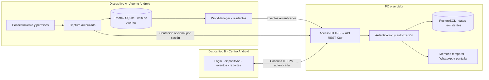
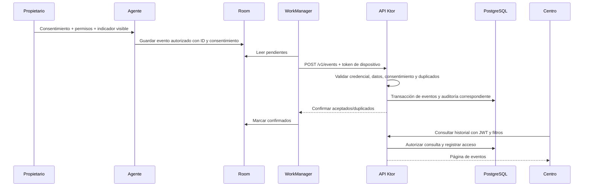
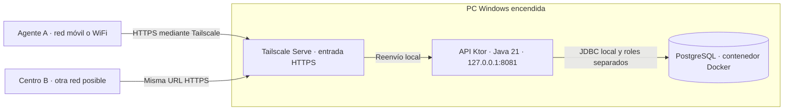

# AuditLab — arquitectura actual

Actualizado: 29 de octubre de 2026, America/Lima. Agente 0.7.1, Centro 0.7.3, API 0.7/V9.
Centro 0.7.2 cambia la presentación de vistas previas en Eventos, sin cambiar
el contrato ni la persistencia. [Detalle](WHATSAPP_EVENTOS_0.7.2.md).

## 1. Estructura general

Arquitectura cliente-servidor con dos clientes Android. La API concentra las reglas
comunes y el acceso a datos. El Centro no consulta directamente el teléfono Agente
ni PostgreSQL. El Agente no recibe órdenes remotas que activen capturas de contenido.

Imagen para insertar en PPT: [arquitectura PNG](presentacion/arquitectura.png)
([SVG](presentacion/arquitectura.svg), [fuente editable](presentacion/arquitectura.dot)).

## 2. Componentes internos

| Capa/parte | Implementación | Responsabilidad |
| --- | --- | --- |
| UI Android | Compose, ViewModel, AgentSession/ControlSession | Pantallas, estado y acciones del usuario. |
| Lógica compartida | apps/common, AgentCore/ControlCore, modelos y EventCodec | Contratos, validación, sesión, captura/envío y consultas. |
| Adaptadores del Agente | RoomAgentJournal, ApiClient, KeystoreCredentialStore | Persistencia local, HTTP y protección de credenciales. |
| Trabajo persistente | WorkManager/SyncScheduler | Enviar eventos pendientes con red y limpiar datos vencidos. |
| Captura Android | RealMonitoringService, WhatsAppNotificationListener, ScreenShareService | Proveedores autorizados, notificaciones y pantalla. |
| Servidor HTTP | Rutas Ktor/Netty | Validación de peticiones y respuestas de la API. |
| Seguridad del servidor | AuthService, sesiones, hashes y roles | Diferenciar usuarios y dispositivos; autorizar cada operación. |
| Persistencia del servidor | JDBC/HikariCP, PostgreSQL, Flyway | Transacciones, consultas, restricciones y evolución del esquema. |
| Contenido efímero | WhatsAppPreviewHub y ScreenShareHub | Límites de memoria, sesión, caducidad y parada. |

La organización separa presentación, lógica y adaptadores; no se afirma que todas
las rutas estén divididas en repositorios o que el proyecto implemente íntegramente
un patrón Clean Architecture. Varias rutas del backend ejecutan SQL mediante JDBC.

### Versiones principales del código actual

| Elemento | Versión/configuración |
| --- | --- |
| Kotlin / Android Gradle Plugin | 2.1.20 / 8.9.2. |
| Android | Mínimo API26; compile/target API35. |
| Compose BOM | 2025.04.01. |
| Room / WorkManager | 2.7.2 / 2.10.1. |
| Ktor | 3.1.2, motor Netty. |
| PostgreSQL del paquete Windows | 17.6, imagen fijada por digest. |
| Flyway / HikariCP | 11.20.3 / 6.3.3. |
| JDK para construir/operar | 21; bytecode JVM17. |

## 3. Dos recorridos de datos

### 3.1 Eventos persistentes

Si falla la red, los eventos permanecen pendientes; los mismos IDs permiten
reintentar sin duplicar datos. Lotes: hasta 100 eventos y un presupuesto de bytes
inferior al máximo HTTP de 256 KiB. No se promete envío inmediato: WorkManager y
Android planifican los trabajos. El estado de entrega se muestra al propietario.

### 3.2 Contenido temporal

- **WhatsApp:** autorización adicional local → sesión autenticada → notificación
  nueva entregada por Android → vista previa temporal en API → consulta del Centro.
  El heartbeat de 0.7.1 funciona cada 8 s sin adquirir el bloqueo de la cola durable.
  El Centro consulta aproximadamente cada 3 s mientras esa vista está en primer plano.
- **Pantalla:** autorización MediaProjection → captura JPEG → último cuadro en
  memoria del servidor → consulta del visor. Aproximadamente 1 cuadro/s.
- Estas rutas no usan la cola Room ni almacenan contenido en PostgreSQL.
  Los metadatos de actividad WhatsApp y accesos sí tienen su recorrido persistente.
- WhatsApp: 20 vistas previas/5 min, sesión inactiva tras 30 s sin comunicación.
  Pantalla: cuadro caducado tras 5 s. Detener o revocar limpia el contenido temporal.

## 4. Despliegue Windows con Tailscale

En esta instalación Tailscale termina HTTPS y reenvía al puerto local de la API.
PostgreSQL no se publica a Internet. Los tres equipos deben poder comunicarse por
la configuración privada autorizada. Un despliegue con dominio/proxy HTTPS es
otra posibilidad, no evidencia de que ya esté operando en producción.
`/ready` indica disponibilidad de la API/BD; no verifica una credencial ni una sesión WhatsApp.

## 5. Autenticación y permisos

- **Centro:** usuario/contraseña; access token JWT y refresh con rotación. El servidor
  verifica sesión, rol y operación. Contraseñas de usuarios con hash Argon2id.
- **Agente:** código de inscripción de un uso/10 min → token opaco de dispositivo.
  No usa el JWT del administrador. La API conserva hash de la credencial.
- **Android:** credenciales cifradas mediante Keystore; permisos de plataforma y
  autorizaciones locales independientes para funciones opcionales.
- **Consentimiento:** un contexto ligado al dispositivo acompaña cada evento.
- **Revocación:** local bloquea captura/envío; remota rechaza nuevas operaciones y
  el teléfono la conoce al volver a contactar. Sin red no es instantánea.
- **BD:** identidades separadas para migración, ejecución y mantenimiento.
- **Auditoría:** registra quién consulta/modifica qué, resultado y momento; sin
  cuerpos WhatsApp ni imágenes en los registros de acceso.

## 6. Modelo y API

Evento en transporte: `eventId`, `timestamp`, `category`, `direction`,
`sourceDevice`, `consentContext`, `isSimulated` y `metadata` permitido.
El servidor agrega `receivedAt`. Los nombres de clases locales pueden usar
`consent`; el contrato JSON utiliza `consentContext`.

| Operación | Ruta real |
| --- | --- |
| Login / refresh / logout | POST /v1/auth/login, /v1/auth/refresh, /v1/auth/logout |
| Crear código / inscribir | POST /v1/devices/enrollment-code, /v1/devices/enroll |
| Listar / detalle | GET /v1/devices, /v1/devices/{deviceId} |
| Lote / historial | POST /v1/events, GET /v1/events |
| Detalle de evento | GET /v1/devices/{deviceId}/events/{eventId} |
| CSV | GET /v1/events/export.csv |
| Revocación admin / propietario | POST /v1/devices/{deviceId}/revoke, /v1/devices/{deviceId}/consent-revoke |
| Auditoría | GET /v1/audit-log |
| Iniciar / terminar WhatsApp | POST /v1/devices/{deviceId}/whatsapp-sharing; DELETE /v1/devices/{deviceId}/whatsapp-sharing/{sharingId} |
| Publicar / consultar vista previa | POST/GET /v1/devices/{deviceId}/whatsapp-previews |
| Mantener sesión WhatsApp | POST /v1/devices/{deviceId}/whatsapp-sharing/{sharingId}/heartbeat |
| Publicar / consultar pantalla | POST/GET /v1/screen-share/{deviceId}/frame |
| Terminar pantalla | DELETE /v1/screen-share/{deviceId} |

Contratos: [principal](../contracts/openapi.yaml),
[WhatsApp](../contracts/whatsapp-preview.openapi.yaml) y
[pantalla](../contracts/screen-share.openapi.yaml).
[Tablas y migraciones](base-datos.md).

## 7. Ubicación en el repositorio

- apps/agent: app Agente y adaptadores Android.
- apps/control: app Centro y visor.
- apps/common: modelos, cliente HTTP propio y lógica compartida.
- apps/design: carpeta de UI compartida incluida por ambos proyectos; no es un módulo Gradle independiente.
- backend/ktor: API, seguridad, SQL y migraciones V1–V9.
- contracts: contratos OpenAPI; docs: manuales, plan y evidencias.
- academic y backend/api: trabajo/prototipo histórico; no representan el servidor
  actual ni deben confundirse con los APK 0.7.1.

## 8. Límites de la arquitectura actual

El contenido efímero se guarda por proceso: reiniciar la API termina esas sesiones;
varias instancias necesitarían afinidad de sesión o un relay compartido que aún no
se ha implementado. El diseño de Windows actual opera con una API central.

La pantalla es actualización de imágenes, no WebRTC ni cámara remota. WhatsApp
no es una integración oficial con la base de chats y depende de las notificaciones
que Android entregue. La corrección 0.7.1 está compilada, pero la recepción real
en el teléfono del usuario no está confirmada. [Estado del producto](CONTEXTO_PRODUCTO.md).
