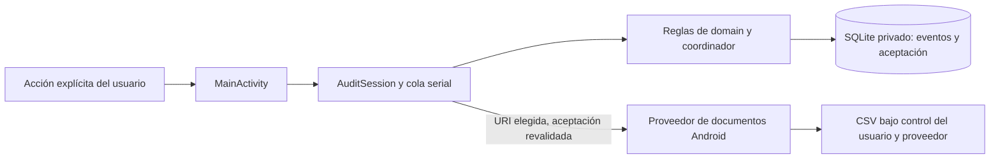

# AuditLab académico — revisión de seguridad I11

Fecha: 23 de octubre de 2026, UTC. Ámbito: la app local `academic/`, módulos `app` y `domain`. La solicitud «Continúa hasta acabarlo» autoriza I11/I12 y la repetición de pruebas. El sistema histórico de dos apps/API y la fase 2 siguen fuera de este cierre.

## Datos y límites de confianza

La app crea únicamente eventos ficticios al pulsar un botón, después de guardar la aceptación. No tiene permisos de comunicaciones, clientes de red, servicios, receptores, proveedores ni arranque automático. La única Activity exportada es el launcher; no interpreta extras externos para aceptar, generar o exportar.



El proveedor de documentos es externo: puede cancelar, denegar, fallar o conservar una salida parcial. La app informa el resultado, no registra la URI ni presume poder borrar todas las copias. La instantánea exportada se valida antes de abrir el destino. Los tickets son de un solo uso, están en memoria y se invalidan al borrar/revocar; tras perder el proceso no se recupera un ticket viejo.

## Hallazgos y correcciones

| ID | Riesgo observado | Corrección y comprobación |
| --- | --- | --- |
| SEC-01 | La limpieza de una exportación fallida podía eliminar un documento existente aunque el proveedor hubiera rechazado abrirlo. | Marcar el stream abierto después de obtenerlo. Prueba con documento sintético preexistente y proveedor que rechaza `wt`: los bytes anteriores se conservan. El fallo de escritura tras abrir sigue intentando retirar la salida parcial. |
| SEC-02 | SecurityException al iniciar un selector restringido no se traducía a error visible. | Capturar la denegación, consumir el ticket y permitir reintentar. Casos de selector ausente y acceso denegado, sin cierre de la app ni éxito falso. |
| SEC-03 | Cursor.getLong/getInt podían convertir texto dañado, decimales o enteros truncados en valores aparentemente válidos. | Verificar tipos INTEGER/TEXT y comparar booleanos como Long antes de crear modelos. Datos malformados provocan StorageException: bloquean generación/exportación; todavía se puede intentar revocar. Las pruebas dañan solo bases con UUID de test y restauran sus restricciones. |

Las tres regresiones de SEC-01/SEC-03 se ejecutaron primero sobre el código de I10: 52 casos, 3 fallos nuevos y 49 anteriores aprobados. Se conserva ese intento; no se presenta como satisfactorio. SEC-02 se verifica con dos pruebas adicionales después de corregirlo. Resultados y hashes en [evidencia I11](evidencias/academico/I11-2026-10-23.md); la versión final se identifica en [I12](evidencias/academico/I12-2026-10-23.md).

## Controles revisados

| Área | Control y evidencia |
| --- | --- |
| Manifiesto efectivo | Se inspecciona dentro de cada APK: ningún permiso, solo launcher exportado, Application de producción, sin fixtures de instrumentación en Dex. Debug y release se revisan por separado. |
| Copias y transferencia | allowBackup=false, fullBackupContent=false. dataExtractionRules excluye los nueve dominios en cloud-backup y device-transfer. El checker resuelve el ID realmente referido por el manifiesto y revisa todas sus configuraciones, incluso rutas renombradas por el optimizador release. No equivale a una transferencia física entre OEMs. |
| Red y capacidades | Sin INTERNET ni librerías de red; usesCleartextTraffic=false explícito. Sin accesibilidad, escucha de notificaciones o permisos de comunicaciones en el código principal. La automatización de pruebas no forma parte del APK principal. |
| SQLite | Columnas y valores enlazados con argumentos/ContentValues; orden/cupo/tabla son constantes. Count+insert y DELETE transaccionales. Retirada en una transacción independiente anterior a DELETE. Migración 1→2 conserva eventos. Decodificación estricta ante daño. |
| Hilos y ciclo de vida | Una sesión/coordinador/cola por proceso. Al cerrar la Activity se retiran observadores; cierre de SQLite detrás de operaciones pendientes. No se sustituyen las instancias al rotar. |
| CSV | Orden estable, UTF-8/CRLF, cabecera fija, timestamps numéricos, escape de comas/comillas/saltos y neutralización de fórmulas. Modelo sin textos de comunicaciones ni campos libres de terceros. |
| Errores y logs | Mensajes estáticos en español; no se imprimen excepciones, URIs, eventos o decisiones desde producción. Fallar no se convierte en éxito vacío. |
| Herramientas | Versiones exigidas conservadas; checksum del Gradle Wrapper presente; repositorios Google/Maven Central/Plugin Portal. Sin nuevas dependencias de la app ni de tests JVM. |
| Artefactos y claves | APK debug firmado e identificado; release compilado sin debuggable y todavía sin firma de distribución. Llaves, bases, caches, APKs y logs generados fuera de Git. |

## Comprobación reproducible

Desde la raíz, sin nuevas bibliotecas:

```bash
python3 academic/tools/check_security.py
python3 -m unittest discover -s academic/tools -p test_check_security.py -v
python3 academic/tools/check_security.py --apk academic/app/build/outputs/apk/debug/app-debug.apk --aapt2 RUTA_SDK/build-tools/36.0.0/aapt2 --variant debug
python3 academic/tools/check_security.py --apk academic/app/build/outputs/apk/release/app-release-unsigned.apk --aapt2 RUTA_SDK/build-tools/36.0.0/aapt2 --variant release
```

El checker es una política específica del proyecto, no un analizador completo de Kotlin ni un escáner de vulnerabilidades. Sus 14 pruebas negativas comprueban rechazos de permisos, componentes, flags, exclusiones incompletas, salida aapt2 inesperada y variantes de recursos optimizados. Se complementa con revisión de código y pruebas ejecutadas en Android.

## Prácticas SSDF seleccionadas

Referencia: [NIST SP 800-218, SSDF 1.1](https://doi.org/10.6028/NIST.SP.800-218). Esta tabla relaciona prácticas con trabajo concreto; no declara certificación ni cumplimiento de una rúbrica aún no recibida.

| Práctica | Aplicación en este proyecto |
| --- | --- |
| PO.1 / PO.4 | Contexto, matriz AC-01–AC-12 y criterios de comprobación explícitos; pruebas con conteos reales y límites declarados. |
| PO.3 | Wrapper con hash, herramientas fijadas y comandos reproducibles; configuración del entorno sin valores de secretos en Git. |
| PS.2 / PS.3 | Firma debug verificada, SHA-256 y revisión de fuente registrados, artefactos de entrega identificados; llave fuera de Git. |
| PW.1 / PW.9 | Consentimiento pendiente por defecto, datos simulados, app sin red, backup excluido y retirada previa a limpieza. |
| PW.5 | SQL parametrizado, decodificación estricta, CSV defensivo y manejo explícito de errores del proveedor. |
| PW.7 | Diff y manifiestos/recursos efectivos revisados, hallazgos SEC-01–SEC-03 y regresiones registradas. |
| PW.8 | JVM, SQL host, políticas negativas, Android y recorrido con selector real/detención del proceso; sus alcances se distinguen. |
| RV.2 / RV.3 | Reproducir fallos, corregir su causa y repetir casos antiguos y nuevos; conservar también los intentos fallidos. |

## Límites de la revisión

Los eventos se eliminan lógicamente de SQLite; no se promete borrado forense del almacenamiento flash o de respaldos externos previos. Una retirada cuya escritura falla no puede prometer persistencia: la sesión se bloquea y ofrece reintento. CSVs exportados quedan fuera del borrado local.

La firma debug identifica una compilación de desarrollo; la publicación/distribución release requiere una llave y el procedimiento del curso. No se ha ejecutado un escáner CVE ni se afirma ausencia universal de vulnerabilidades. Se mantienen las versiones indicadas por el usuario. Sync de Android Studio, teléfono físico y rúbrica/PDF requieren evidencia propia; el [avance académico](AVANCE_ACADEMICO.md) registra el alcance realmente alcanzado y la situación de Android 16.
