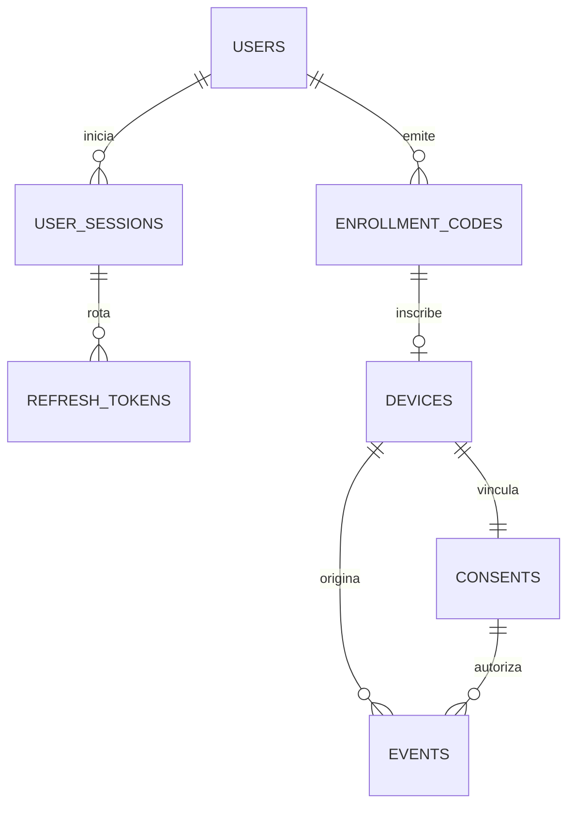

# PostgreSQL, migraciones y bootstrap

Relación: P2.3 y P3.1. El backend definitivo usa JDBC/Hikari y migraciones Flyway en `backend/ktor/src/main/resources/db/migration`. El prototipo SQLite permanece independiente; no se migran datos personales ni se copian sus credenciales.

## Modelo



| Tabla | Restricciones y finalidad |
| --- | --- |
| `users` | UUID, nombre único sin distinguir mayúsculas, rol admin/auditor, estado y hash Argon2id; nunca contraseña en claro. |
| `user_sessions` | Usuario, creación, expiración absoluta y revocación; verificar estado en cada petición protegida. |
| `refresh_tokens` | Hash único, sesión, consumo/revocación y padre. Un padre tiene un solo hijo y pertenece a la misma sesión. |
| `enrollment_codes` | Hash único, creador, expiración, consumo y dispositivo. Las referencias diferidas obligan a concordar con el código del dispositivo. |
| `devices` | Código exclusivo, hash de credencial, consentimiento y estados active/revoked coherentes con fecha. |
| `consents` | Un consentimiento por identidad de dispositivo, política, aceptación, recepción y revocación. Reinscripción usa nueva identidad. |
| `events` | Clave primaria `(device_id,event_id)`, FK de consentimiento/dispositivo, timestamps, simulación, enums y metadatos JSONB permitidos. `payload_hash` sirve para comparar reintentos normalizados en P3.3. |
| `auth_rate_limits` | V2: HMAC de ámbito/identificador, ventana y contador; límites compartidos sin credenciales ni identificadores en claro. |
| `audit_log` | Actor/tipo, acción, recurso/filtros mínimos, resultado, hora y correlación. API solo inserta/consulta; sin FK destructiva a cuentas para no borrar trazabilidad al limpiar registros. |

Hay índices para historial y filtros de dispositivos/eventos, recepción usada en retención, auditoría por actor/acción y expiración de códigos/sesiones. Las consultas finales y su rendimiento se verificarán al implementarlas.

La BD limita campos/valores de metadatos e impide asociar un consentimiento a otro dispositivo. La API aún debe validar política/fecha exactas, tamaño de lote, reloj, autorización, conflicto de contenido, cursores y retención. Una PK por sí sola no implementa una respuesta idempotente.

## Tres identidades PostgreSQL separadas

1. **Migración:** crea/actualiza `auditlab` y aplica grants/bootstrap; credenciales solo en comandos administrativos, no en el servidor en ejecución.
2. **Runtime:** consulta usuarios, gestiona sesiones/códigos/estados y contadores de autenticación, y agrega eventos/auditoría. No cambia cuentas, esquema, historial de migraciones ni eventos/auditoría existentes.
3. **Mantenimiento:** puede consultar/eliminar datos de retención, sin reescribir auditoría ni crear usuarios. La selección de datos vencidos será responsabilidad del job de P3.5.

El operador crea roles PostgreSQL dedicados, sin superusuario, CREATEDB, CREATEROLE ni membresías. El comando de grants rechaza roles administrativos, dueños de BD/esquema/tablas o con membresías y no crea roles ni asigna contraseñas de PostgreSQL. En desarrollo `compose.yaml` proporciona un usuario bootstrap privilegiado; no utilizarlo como cuenta runtime.

Ejemplo de preparación de roles con un operador autorizado, sobre una BD de desarrollo `auditlab`:

```sql
CREATE ROLE auditlab_migrator LOGIN NOSUPERUSER NOCREATEDB NOCREATEROLE;
CREATE ROLE auditlab_api LOGIN NOSUPERUSER NOCREATEDB NOCREATEROLE;
CREATE ROLE auditlab_maintenance LOGIN NOSUPERUSER NOCREATEDB NOCREATEROLE;
GRANT CONNECT, CREATE ON DATABASE auditlab TO auditlab_migrator;
```

Asignar sus contraseñas por el mecanismo seguro del servidor o `\password <rol>` dentro de psql; no escribirlas en archivos SQL, URLs JDBC, comandos registrados ni Git. La BD debe existir. Las credenciales PostgreSQL son distintas de las cuentas admin/auditor de AuditLab.

## Comandos administrativos

Construir desde raíz: `python3 scripts/gradle.py :backend:ktor:installDist --no-daemon`.

Para migraciones y bootstrap, suministrar externamente `AUDITLAB_MIGRATION_JDBC_URL`, `AUDITLAB_MIGRATION_USER`, `AUDITLAB_MIGRATION_PASSWORD`. URL de desarrollo ilustrativa: `jdbc:postgresql://127.0.0.1:5432/auditlab`; sin credenciales dentro de la URL. Configurar TLS apropiado al servicio fuera del entorno local.

```bash
backend/ktor/build/install/ktor/bin/ktor migrate
```

El comando valida checksums y aplica solo versiones pendientes; repetirlo no borra ni reinicializa datos. `clean` está deshabilitado. No editar una migración aplicada a una BD que deba conservarse: crear V2, V3, etc. La política de rollback/restauración de entrega se completa en P8.1.

Después de cada migración que agregue tablas, repetir los grants. Para aplicar los permisos, usar la cuenta de migración y el nombre no secreto del rol objetivo:

```bash
AUDITLAB_TARGET_DB_ROLE=auditlab_api backend/ktor/build/install/ktor/bin/ktor grant-runtime
AUDITLAB_TARGET_DB_ROLE=auditlab_maintenance backend/ktor/build/install/ktor/bin/ktor grant-maintenance
```

Para crear una cuenta AuditLab, suministrar `AUDITLAB_BOOTSTRAP_USERNAME`, `AUDITLAB_BOOTSTRAP_PASSWORD` y `AUDITLAB_BOOTSTRAP_ROLE` (`admin` o `auditor`) por configuración segura y ejecutar:

```bash
backend/ktor/build/install/ktor/bin/ktor bootstrap-user
```

La contraseña debe tener de 12 a 128 caracteres. Se almacena Argon2id con sal aleatoria de 16 bytes, memoria 19456 KiB, 2 iteraciones, paralelismo 1 y salida de 32 bytes. Al verificar se leen los parámetros codificados en el hash. Repetir bootstrap no cambia contraseña ni rol de una cuenta existente; una diferencia de rol falla. La creación y su auditoría se confirman en la misma transacción. No existe contraseña predeterminada, usuario automático al arrancar ni endpoint administrativo de bootstrap expuesto por HTTP.

## Servidor y disponibilidad

Para usar PostgreSQL en Ktor, suministrar las tres variables `AUDITLAB_DB_JDBC_URL`, `AUDITLAB_DB_USER`, `AUDITLAB_DB_PASSWORD` de la cuenta runtime. Si no se configura ninguna, arranca solo salud de proceso; una configuración parcial falla. El servidor nunca ejecuta migraciones automáticamente con privilegios elevados.

`GET /health` indica proceso vivo. `GET /ready` responde `200 {"status":"ready"}` si la cuenta runtime puede conectar y consultar la tabla requerida, o `503 {"status":"unavailable"}` si no está configurada o falla. No implica que las rutas de negocio ya existan ni sustituye la comprobación completa prevista para P3.6. Hikari usa hasta 5 conexiones y espera de adquisición de 2 segundos.

## Reglas para implementar transacciones futuras

- Inscripción: bloquear código válido, insertar dispositivo y consentimiento, marcar consumo, insertar auditoría y confirmar antes de devolver token. Las FKs circulares son diferidas para permitir esa transacción, pero no permiten confirmar sin la relación completa.
- Ingesta/revocación: bloquear la misma fila de dispositivo y comprobar estado/consentimiento; persistir el lote atómico o revocación y auditoría, confirmar antes de responder. La estructura no realiza estas operaciones por sí sola.
- Refresh: bloquear primero sesión y después releer el padre, comprobar vencimiento/consumo, registrar hijo y consumo o invalidar familia ante reutilización, en una transacción. Implementado en P3.1; detalles en [autenticación](autenticacion.md).
- Retención: usar exclusivamente la cuenta de mantenimiento y borrar primero eventos/referencias vencidas antes de registros padre; comprobar las fechas y política, no solo permisos. No depender del tráfico de consultas.

## Verificación aislada

```bash
python3 scripts/check_database.py
```

Requiere Docker y el toolchain local. Crea un contenedor/BD/roles temporales, ejecuta tests JVM sobre PostgreSQL real, prueba los comandos migración/bootstrap/grants y el servidor con BD disponible y detenida, autenticación y refresh tras reiniciar su proceso. No usa valores de conexión de una BD del usuario. Las pruebas de integración rechazan una BD que no sea la fixture identificada. Los resultados están en `backend/ktor/build/test-results/`; diagnóstico saneado en `.tooling/database-check.log`.
